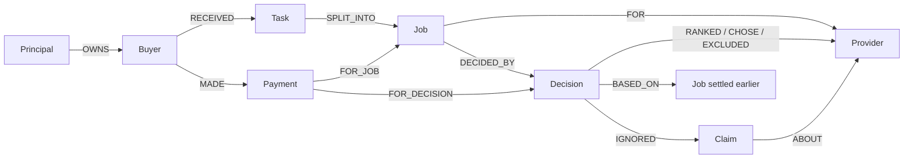
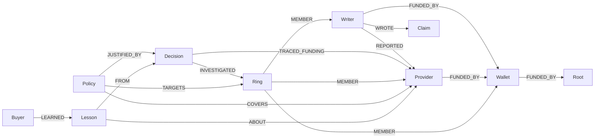

# TRACE-Graph

Buyer agents that hire and pay other agents, and decide whom to trust from one shared FalkorDB graph.

Five buyer agents take tasks, split them into jobs, and pay provider agents through escrow. Before a buyer pays anyone, it asks the graph who has actually delivered, for whom, and who paid for the reviews. Every buyer's outcomes go into the same graph, so one buyer's refund protects the other four. Shared memory is also an attack surface: fake reviews from Sybil writers would make sharing worse than not sharing at all. So every review passes a write guard, a Cypher question FalkorDB answers per write: does this writer share a funding root with the provider it rates? Reviews that fail are kept as `:Claim` nodes, visible on the receipt, and never counted.

When the scores look wrong, the agent follows the money (`algo.SPpaths`), finds the ring (`algo.WCC`, `algo.labelPropagation`, `algo.pageRank`, `algo.betweenness`), quarantines it with a `:Policy` node every buyer respects, and writes a lesson it recalls through the vector index next time.

## Tracks

| Track | What we enter |
|---|---|
| 01, agents that decide and act on connected data (primary) | The buyer agent: TRACE scores computed inside FalkorDB pick the provider, the agent pays into escrow, settles, investigates and quarantines, all through typed MCP tools over the graph |
| 02, shared memory (bonus) | One graph is the only channel between five concurrent buyers; the write guard gives it integrity; lessons are shared through the vector index; AOF persistence; one named graph per tenant view |
| 03, explainable context (bonus) | `who_authorised`: one traversal from a payment to the decision, the counted evidence and its writers, the buyer and the principal that owns it |

## Run it

You need Python 3.12, [uv](https://docs.astral.sh/uv/) and a FalkorDB server. We run on the free tier of [FalkorDB Cloud](https://app.falkordb.cloud); `docker compose up -d` gives you the same server locally (FalkorDB v4.22.0 with AOF, Browser on http://localhost:3000).

```sh
uv sync
cp .env.example .env                  # FALKORDB_URL and an LLM key; GitHub Models serves gpt-4o-mini for free
uv run tracegraph-seed                # the demo market, each buyer's private copy, the TRACE UDF
uv run tracegraph-api                 # HTTP API on http://localhost:8000, docs at /docs
```

The site is in `web/` (React and TypeScript, built with Vite). Build it once and the API serves it at `/`, so the whole demo is one process and one URL:

```sh
cd web && npm install && npm run build && cd ..
uv run tracegraph-api                 # the site on http://localhost:8000, the API beside it
```

For work on the site, `npm run dev` in `web/` serves it on http://localhost:5173 and forwards API calls to `API_TARGET` (default `http://127.0.0.1:8000`).

The guard switch and the unplug button only show when the address ends in `/?operator`, and they still need `ADMIN_TOKEN`.

Or skip the site, give a buyer a task and watch it work:

```sh
curl -X POST localhost:8000/tasks -H 'content-type: application/json' \
  -d '{"buyer_id": "buyer-1", "text": "Summarise: FalkorDB stores graphs as sparse matrices."}'
curl -N localhost:8000/tasks/task-1/events
```

For the live demo, seed without the ring and let it arrive mid-run:

```sh
uv run tracegraph-seed --no-ring
curl -X POST localhost:8000/admin/ring -H 'admin-token: <ADMIN_TOKEN>'
```

The proof runs, both stored in FalkorDB and served by the API:

```sh
uv run tracegraph-scoreboard --seeds 100              # Section 7.3 market, 7 lanes, no LLM; resumes if cut off
uv run tracegraph-agent-eval --cases 100               # L1 and L2: the same model with and without the graph
```

The buyer's tools also work from any MCP client. Over stdio, for Claude Desktop or an IDE:

```json
{"mcpServers": {"tracegraph": {"command": "uv", "args": ["run", "tracegraph-mcp"], "cwd": "/path/to/trace-graph"}}}
```

or over HTTP at `/mcp` with `MCP_OVER_HTTP=true`.

The free tier has 100 MB of memory, no persistence and no TLS, and it stops an instance nobody has used for a day. So the scoreboard and the agent eval write a copy of each run to `results/` before storing it in FalkorDB, and `tracegraph-seed` (or `POST /admin/seed`) stores those runs again after a restart. The 100-seed scoreboard does not fit in 100 MB: one market of the paper's Section 7.3 has 1,000 providers, and the free instance is restarted after about 14 of them. It runs on GitHub Actions instead (Actions, Scoreboard, Run workflow), against the same `falkordb/falkordb:v4.22.0` image as a service container. Put the `scoreboard` artifact in `results/` and run `tracegraph-seed`, and the cloud instance serves it. Run locally, the scoreboard picks up from the last finished market if it is cut off. The `Check` workflow runs `check.sh`, every database test included, against the same image on each push. The save queries skip a run that is already there. Without TLS the password crosses the network unencrypted, which is fine for synthetic data and nothing else.

Tests: `./check.sh` runs formatting, lint, strict mypy, the style rules, the QUERIES.md freshness check and pytest. Tests marked `falkordb` run when the database is up and skip otherwise.

## Graph data model

The whole market is one graph. The first map follows a hire from the company to the payment; the second shows the money behind the reviews, which is where rings get caught. The site's opening graph draws the same thing live from FalkorDB.

**A hire, from the company to the payment**



**Reviews, money and the ring**



Before a review counts, the guard asks two questions of this map: is the writer an admitted buyer, and does it share a funder with the provider it praised?

```
(w:Writer)-[:REPORTED]->(p:Provider)
(w)-[:FUNDED_BY*1..3]->(funder)<-[:FUNDED_BY*1..3]-(p)
```

A review that fails either check becomes a `Claim` the decision ignores, with the reason on it. When the agent follows the money with `funding_path`, the path it found is saved on the decision as `TRACED_FUNDING`, and the receipt shows it.

### Nodes

| Label | What it is | Key properties |
|---|---|---|
| `Principal` | The company that owns buyers | `id`, `name` |
| `Buyer` (also `Writer`) | A buyer agent | `id`, `name`, `admitted`, `balance_sats` |
| `Writer` | Anyone who can write a review, including outside writers | `id` |
| `Provider` | An agent that sells a capability | `id`, `name`, `capability`, `price_sats`, `earned_sats` |
| `Wallet`, `Root` | Where money comes from; a `Root` is the top of a funding chain | `id` |
| `Task` | What a buyer was asked to do | `id`, `text`, `created_at` |
| `Job` | One capability of a task | `id`, `capability`, `input_text`, `status`, `price_sats` |
| `Decision` | One `trace_score` call | `id`, `status`, `flags`, `scorer`, `view`, `guard`, `graph_ms` |
| `Payment` | Escrow for one job | `id`, `sats`, `status` (held, released, refunded), `verdict_reason` |
| `Claim` | A review the guard did not count, and why | `id`, `reason` |
| `Ring` | A group `find_ring` found | `id`, `hub_id`, `bridge_id`, `size` |
| `Policy` | A quarantine every buyer's scoring respects | `id`, `kind`, `reason`, `created_by` |
| `Lesson` | What a buyer learned, embedded for recall | `id`, `text`, `embedding` (vector) |

### Relationships

```
(:Principal)-[:OWNS]->(:Buyer)-[:RECEIVED]->(:Task)-[:SPLIT_INTO]->(:Job)-[:FOR]->(:Provider)
(:Buyer|:Writer)-[:REPORTED {ok, t, job_id}]->(:Provider)
(:Buyer|:Writer|:Provider|:Wallet)-[:FUNDED_BY]->(:Wallet|:Root)
(:Job)-[:DECIDED_BY]->(:Decision)
(:Decision)-[:RANKED {position, utility, lcb, risk, ppr_distance, entropy, sybil, clique}]->(:Provider)
(:Decision)-[:EXCLUDED {reason}]->(:Provider)
(:Decision)-[:BASED_ON]->(:Job)
(:Decision)-[:IGNORED]->(:Claim)-[:ABOUT]->(:Provider),  (:Writer)-[:WROTE]->(:Claim)
(:Decision)-[:CHOSE]->(:Provider)
(:Buyer)-[:MADE]->(:Payment)-[:FOR_JOB]->(:Job),  (:Payment)-[:FOR_DECISION]->(:Decision)
(:Decision)-[:TRACED_FUNDING {writer_id, node_ids, hops}]->(:Provider)
(:Decision)-[:INVESTIGATED]->(:Ring)-[:MEMBER]->(:Provider|:Writer|:Wallet)
(:Policy)-[:TARGETS]->(:Ring),  (:Policy)-[:COVERS]->(:Provider),  (:Policy)-[:JUSTIFIED_BY]->(:Decision)
(:Buyer)-[:LEARNED]->(:Lesson)-[:FROM]->(:Decision|:Policy),  (:Lesson)-[:ABOUT]->(:Provider|:Ring)
```

### Named graphs

| Graph | Holds |
|---|---|
| `market` | The shared market every buyer reads and writes (the Together view) |
| `market:private:buyer-N` | One buyer's own copy (the Alone view, the paper's partitioned setting) |
| `ops` | The LLM spend meter, agent eval results, investigator question counts |
| `scoreboard` | Scoreboard runs: `(:ScoreboardRun)-[:MEASURED]->(:LaneResult)-[:FROM_SEED]->(:SeedResult)` |
| `eval:<lane>-<adversary>:<seed>` | A scoreboard market while it runs; deleted afterwards |

Every labelled node has a unique `id` constraint and a range index. `Provider.capability` and the `REPORTED.t` edge property are indexed. `Lesson.embedding` has a cosine vector index.

## Cypher and graph algorithms

All 59 queries are in [docs/QUERIES.md](docs/QUERIES.md), generated from the code. The ones that carry the idea:

- **`candidate_evidence` and `trace_scores`**: one query collects every report on the job's candidate providers, runs the write guard on each (admitted writer, and no shared funder within three `FUNDED_BY` hops), and hands the counted evidence to the TRACE utility, which runs inside FalkorDB as a JavaScript UDF (`src/tracegraph/graph/udf/trace_score.js`). A Python copy of TRACE is kept for the parity test and the `SCORER=python` switch.
- **`funding_path`**: `algo.SPpaths` from an uncounted writer to the provider it praised, over `FUNDED_BY`.
- **`find_ring`**: `algo.WCC` over funding links, `algo.labelPropagation` over funding and praise, `algo.pageRank` for the hub, `algo.betweenness` for the wallets that broker it.
- **`quarantine_ring`**: writes a `Policy` only when a traced funding path actually reaches the ring.
- **`similar_lessons`**: `db.idx.vector.queryNodes` over `Lesson.embedding`, then the graph around each lesson.
- **`who_authorised`**: payment to decision to buyer to principal in one path.
- **`recorded_decision` and the `$as_of` evidence read**: the what-if receipt replays a stored decision against the graph as it was at that moment, with a different guard.

## Take FalkorDB away

Evidence, provenance, scores, decisions, payments, policies and memory exist only in FalkorDB. There is no copy in Python or in files. The one exception is the finished eval results in `results/`, a copy kept because the free tier forgets everything on a restart (D38); the agent never reads them. Stop the database (or `POST /admin/plug {"connected": false}` on the live deploy) and every tool refuses: `trace_score` cannot score, `hire_with_escrow` cannot pay, and `/health` returns 503. The scoreboard's Alone lane is the other half of the removal test: each buyer keeps its own store, which is what an agent without a shared graph has.

## HTTP API

| Route | What it returns |
|---|---|
| `GET /health` | FalkorDB up or down (503 when down: nobody can pay), guard mode, LLM mode |
| `POST /tasks`, `GET /tasks/{id}`, `GET /tasks/{id}/events` | Start a buyer on a task; its status; its tool calls as server-sent events |
| `GET /graph/snapshot` | Nodes and edges of the shared market or one buyer's private graph |
| `GET /decisions/{id}/receipt` | Ranking, exclusions, counted jobs, ignored claims, investigation, and the Cypher behind it |
| `GET /decisions/{id}/what-if?guard=unguarded` | The same decision replayed as of its own time with another guard: would the pick change, who gains, from which funders |
| `GET /payments/{id}/who-authorised` | Principal, buyer, task, job, decision and provider behind a payment |
| `GET /jobs?payment_status=refunded`, `GET /quarantines` | Recent agent jobs with their payments; every quarantine in force and the decision behind it |
| `GET /jobs/{id}`, `GET /nodes/{id}/funding`, `GET /nodes/{id}/neighbourhood` | The lookups the investigator uses |
| `POST /investigator/ask` | A question answered through eight read-only tools, with the path of node ids used; 10 per visitor |
| `GET /scoreboard`, `GET /scoreboard/live` | The stored 100-seed scoreboard; one lane played live, round by round |
| `GET /evals/agent` | The latest L1 and L2 results |
| `GET /profile/trace-score` | FalkorDB's execution plan and timing for the scoring query |
| `GET /llm/spend` | Paid LLM spend against the $1.80 limit |
| `POST /admin/seed`, `/admin/ring`, `/admin/guard`, `/admin/plug` | Demo controls; need `ADMIN_TOKEN` |
| `GET /` | The site, when `web/dist` is built (`WEB_DIR`) |

## Results

### Agent eval: the same model with and without the graph

100 labelled hiring cases, each played twice by gpt-4o-mini: once as the buyer agent with the FalkorDB tools, once with the same market described as text and no tools. 40 cases are clean, 30 hide a Sybil ring that praises its own provider, and 30 are suspicious but honest (a new provider, a close call, praise from outside writers with no shared funding). Run on FalkorDB Cloud on October 16; the full run cost $0.14. Every case is in [`results/agent-eval.json`](results/agent-eval.json) and served at `/evals/agent`.

| | With the graph | Text only |
|---|---|---|
| Scam providers hired | 0 of 100 | 26 of 100 (26 of the 30 ring cases) |
| Sats paid to scams | 0 | 149 |
| No hire or error | 0 | 0 |

What the agent did with its tools:

- It investigated all 30 ring cases (recall 1.00) and quarantined all 30 rings. Every quarantine is backed by a traced funding path, and none hit an honest provider.
- It also investigated all 30 suspicious-but-honest cases, so investigation precision is 0.50. It quarantined none of them: it checked the funding, found no shared root and hired.
- All 100 final summaries passed the citation check (every id they name is in the graph). The `write_lesson` guard refused 3 lessons that cited ids the model had shortened or made up.

### Scoreboard

The 100-seed scoreboard (mean, median and p90 fraud per lane) runs on GitHub Actions, because it needs more memory than the free tier has (D39). It is stored in FalkorDB and served at `/scoreboard` once it has run.

## Prior own work

This project builds on two earlier projects by the same team. All code in this repository was written from October 15, 2026.

- **TRACE**: Kaushik, Gupta, Vashisht and Bhatt, "TRACE: Graph-Aware Anomaly Detection for Trust Routing in Adversarial Decentralized Marketplaces", CIKM 2026.
  - Carried over: the utility and its weights, the Beta(1,3) lower confidence bound, CUSUM-style default-risk exclusion, personalised PageRank from an honest seed, counterparty entropy, the edge-to-job Sybil ratio, the clique penalty, greedy selection, and the Section 7.3 market contract.
  - New here: the shared FalkorDB evidence graph (the paper's open problem of partitioned views), the poisoning hole that sharing opens, the write guard that closes it, TRACE inside the database as a UDF, and the agent that acts on the scores.
- **SatsRouter**: the earlier public agent-marketplace project. Its concepts (task, 402-style payment handshake, escrow, judge, settle) are rebuilt from scratch on FalkorDB. SatsRouter kept its data in SQLite and scored trust in application code.

## Data

Synthetic only: a generated market of providers, buyers, writers and funding links, and short job texts we wrote. No personal data and no logins.

## More

- [docs/ARCHITECTURE.md](docs/ARCHITECTURE.md): how the pieces fit
- [docs/QUERIES.md](docs/QUERIES.md): every Cypher query
- [docs/DEVIATIONS.md](docs/DEVIATIONS.md): every place the build differs from the plan, and why
- [docs/PHASES.md](docs/PHASES.md) and [docs/BUILD_RULES.md](docs/BUILD_RULES.md): how it was built
