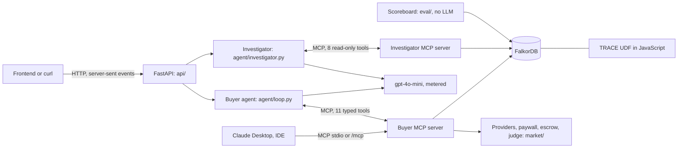

# Architecture

## The picture

The LLM chooses which tool to call. The graph decides who gets paid: `hire_with_escrow` only accepts a provider from the ranked set that `trace_score` stored for that job, and the ranking comes from FalkorDB.

## One job, step by step

1. `POST /tasks` starts `BuyerAgent.run_task`. The planner splits the task into at most three jobs (`open_task` writes `Task` and `Job` nodes).
2. `recall_memory`: vector search over `Lesson.embedding`, plus the buyer's past decisions and the pooled trust in the graph.
3. `trace_score`: one Cypher query gathers the evidence for every provider of the job's capability, applies the write guard and the quarantine policies, and runs TRACE inside FalkorDB. The decision, its ranking, exclusions and ignored claims are written back as a `Decision`.
4. If the decision is confident, `hire_with_escrow`: the provider answers 402 with an invoice, the payment is held, the provider works. If it is flagged, `funding_path`, `find_ring` and `quarantine` run first, then `trace_score` again.
5. `settle`: the judge checks the work, the payment is released or refunded, and the buyer's `REPORTED` edge goes into the shared graph for every other buyer to use.
6. `write_lesson` after a refund or a quarantine. The final narration may only cite ids that exist in the graph, or it is replaced by the receipt.

Each step is an `AgentEvent`, streamed from `/tasks/{id}/events`. Afterwards, `/decisions/{id}/receipt` explains the decision and `/decisions/{id}/what-if` replays it as of its own time with a different guard.

## Packages

| Package | What it holds |
|---|---|
| `config.py` | All settings, read from the environment and `.env` |
| `graph/` | The FalkorDB connection (fails fast and closed), graph names, schema, the `Query` registry in `queries/`, and the TRACE UDF in `udf/` |
| `trace/` | TRACE in Python: reliability (LCB, risk, CUSUM), graph signals (PPR, entropy, Sybil ratio, clique), utility and ranking. Used for the parity test with the UDF and as the `SCORER=python` fallback |
| `evidence/` | The guard rules, reading candidate evidence, scoring in the database or in Python, and recording decisions |
| `market/` | The demo roster, providers and their behaviours, the 402 paywall, escrow, the judge, hiring, and the seed command |
| `investigation/` | Funding paths, ring finding and quarantine, used by the agent's tools and by the scoreboard's quarantine lane |
| `memory/` | Writing lessons and recalling them |
| `llm/` | The OpenAI-compatible chat client, the spend meter, record and replay, embeddings |
| `agent/` | The buyer's MCP server and tools, the agent loop, the planner, the citation check, and the read-only investigator |
| `eval/` | The scoreboard (the paper's Section 7.3 market, seven lanes, 100 seeds) and the agent evals (L1 with and without the graph, L2 tool choice) |
| `api/` | The FastAPI app, background task runs, and the routes |

## Where state lives

Everything a buyer knows, and everything it did, is in FalkorDB: evidence, funding, decisions, payments, policies, lessons, the spend meter, eval results and visitor counts. The API keeps only the in-progress task event lists in memory so they can be streamed; a finished task's record is in the graph. Restarting the API or the agent loses nothing a buyer needs to decide. The FalkorDB Cloud free tier keeps nothing across its own restarts, so the scoreboard and agent eval runs also go to `results/` as the exact parameters of their save queries; seeding stores them again, and the save queries skip a run id that is already in the graph.

## Fail closed

`GraphDatabase.connected_client` checks the port before it connects, and every call has a 15 second limit. A lost server raises `GraphUnavailableError`. The MCP tools turn that into a refusal the agent can read, the API turns it into a 503, and no code path pays a provider without a fresh ranking from the graph.

## Scoreboard

`tracegraph-scoreboard` plays the paper's market (1,000 providers, 30% malicious, 5 buyers, 60 rounds, 100 seeds) once per lane, each in its own FalkorDB graph. Every round, one query reads the previous round's reports with the guard applied, the buyers choose with TRACE, and one batch write records the outcomes. Lanes differ only in what is shared and what is guarded, and every lane on a seed uses the same random draws, so the differences come from the lanes. Results are written to the `scoreboard` graph.
